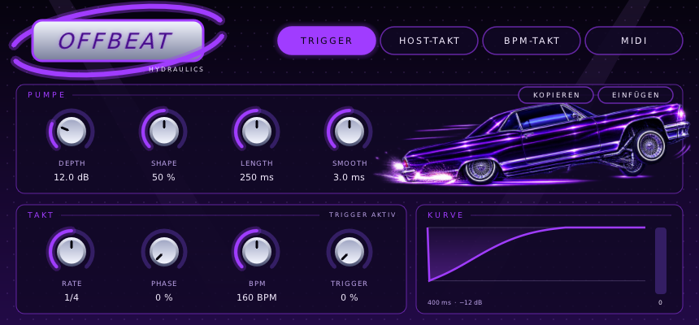

# Offbeat Hydraulics

**Pumpen im Takt der Kick:** Hydraulics duckt Bass, Pads und Leads bei jedem Schlag und lässt sie wieder hochkommen. Das ist das typische Sidechain-Pumpen im Bounce. Die Kurve stellst du über Tiefe, Form und Länge ein. Teil der [Offbeat-Familie](https://github.com/lukestark-glitch/offbeat).



| Formate | Systeme | Lizenz |
|---|---|---|
| VST3 · VST2 · AU · CLAP · LV2 · **LADSPA** (für LMMS) | macOS (Intel + Apple Silicon) · Windows · Linux | ISC (frei nutzbar) |

## Inhalt

- [Was kann Offbeat Hydraulics?](#was-kann-offbeat-hydraulics)
- [Installation](#installation)
- [Welche Quelle in welcher DAW?](#welche-quelle-in-welcher-daw)
- [LMMS: Pumpen mit dem Peak Controller](#lmms-pumpen-mit-dem-peak-controller)
- [Alle Regler](#alle-regler)
- [Einstellungen als JSON](#einstellungen-als-json-kopieren--einfügen)
- [Presets zum Kopieren](#presets-zum-kopieren)
- [Selbst bauen und anpassen](#selbst-bauen-und-anpassen)

## Was kann Offbeat Hydraulics?

- **Pump-Kurve:**
  - **Depth** legt fest, wie tief geduckt wird (bis −48 dB).
  - **Shape** reicht von gleichmäßig bis S-Kurve.
  - **Length** bestimmt, wie schnell es wieder hochkommt.
  - **Smooth** macht den Einsatz weich, damit nichts klickt.
- **Vier Auslöser (Source):**
  - **Trigger:** Ein Regler, den z. B. der LMMS-Peak-Controller von der Kick steuert. Das ist echtes Sidechain, unabhängig vom Tempo.
  - **Host-Takt:** folgt der Song-Position der DAW, mit Rate 1/1 … 1/16 und Phase.
  - **BPM-Takt:** läuft frei mit einem eigenen Tempo.
  - **MIDI:** jede Note löst aus.
- **Anzeige:** Die Oberfläche zeigt die Kurve und als Balken die aktuelle Absenkung.
- **Latenz 0**, 7 Presets, Zahleneingabe, JSON zum Kopieren und Einfügen.
- **LADSPA-Version für LMMS.**

## Installation

**Kurz:** Lade unter [Releases](https://github.com/lukestark-glitch/offbeat-hydraulics/releases) das ZIP für dein System, kopiere das passende Format in den Plugin-Ordner und lass die DAW neu scannen. Hydraulics kommt **auf die Spur, die pumpen soll** (Bass, Pad, Lead oder eine Gruppe davon), **nicht** auf die Kick.

| System | VST3 | AU | CLAP |
|---|---|---|---|
| macOS | `~/Library/Audio/Plug-Ins/VST3/` | `~/Library/Audio/Plug-Ins/Components/` | `~/Library/Audio/Plug-Ins/CLAP/` |
| Windows | `C:\Program Files\Common Files\VST3\` | – | `C:\Program Files\Common Files\CLAP\` |
| Linux | `~/.vst3/` | – | `~/.clap/` |

**LMMS:** Die LADSPA-Datei kommt in den LADSPA-Ordner von LMMS (Einstellungen → Pfade). Unter macOS muss sie auf `.so` enden, also `offbeat-hydraulics-ladspa.dylib` umbenennen in `offbeat-hydraulics-ladspa.so`. `make install` erledigt beides.

Ausführlich für alle Systeme und DAWs: **[Setup-Anleitung](https://github.com/lukestark-glitch/offbeat/blob/main/SETUP.md)**.

## Welche Quelle in welcher DAW?

| DAW | Empfohlene Source | So geht's |
|---|---|---|
| FL Studio, Ableton, Logic, Bitwig, Reaper | **Host-Takt**, Rate **1/4** | Plugin auf die Bass- oder Synth-Spur legen, fertig. Es pumpt auf jeder Viertel, passend zur Four-on-the-floor-Kick. Sitzt das Pumpen nicht genau auf der Kick, dreh an **Phase**. |
| dieselben, Kick mit Breaks | **MIDI** | Die Noten der Kick zusätzlich an Hydraulics schicken (in FL: MIDI Out; in Ableton/Bitwig/Reaper: MIDI-Routing auf das Plugin). Jede Note löst aus. |
| LMMS 1.2 (LADSPA) | **Trigger** | Peak Controller auf der Kick-Spur, mit dem Regler Trigger verbinden ([Anleitung unten](#lmms-pumpen-mit-dem-peak-controller)) |
| LMMS ohne Controller | **BPM-Takt** | BPM auf das Song-Tempo stellen, mit Phase auf die Kick ausrichten (der Takt startet beim Laden des Plugins) |
| Carla | Host-Takt oder MIDI | wie oben; Effekte in Carla wirken nur auf Klänge aus demselben Carla |

## LMMS: Pumpen mit dem Peak Controller

So ist es im Demo-Projekt der [Offbeat-Familie](https://github.com/lukestark-glitch/offbeat) eingestellt und getestet. Gemessen wird die Synth-Spur 30 ms nach jeder Kick etwa 9 dB leiser und ist nach 250 ms wieder oben.

1. **Hydraulics einfügen:**
   - Lege die pumpenden Spuren (z. B. Akkorde und Melodie) im FX-Mixer (F9) auf einen gemeinsamen Kanal.
   - Wähle dort „Add effect“ und nimm **Offbeat Hydraulics**.
   - **Source bleibt 0 (Trigger).**
2. **Peak Controller einfügen:**
   - Lege die **Kick** auf einen eigenen Mixer-Kanal.
   - Füge dort mit „Add effect“ einen **Peak Controller** ein. Er verändert den Klang nicht.
3. **Peak Controller einstellen:** Base **0**, Amount **voll**, Amount Multiplicator **2**, Attack **0**, Decay **0**.
   - So steigt der Wert bei jeder Kick über 0,5 und fällt dazwischen unter 0,3.
   - Ist die Kick sehr leise, Multiplicator höher stellen.
4. **Verbinden:** Rechtsklick auf den Hydraulics-Regler **Trigger** → „Connect to controller…“ → den Peak Controller wählen.
5. **Abspielen:** Bei jeder Kick pumpt der Kanal. **Depth**, **Shape** und **Length** nach Gehör einstellen.

## Alle Regler

| Regler | Bereich | Standard | Was er verändert | Beispiel |
|---|---|---|---|---|
| Source | Trigger · Host-Takt · BPM-Takt · MIDI | Trigger | was das Pumpen auslöst (siehe oben) | Host-Takt in FL Studio und Ableton |
| Trigger | 0 … 1 | 0 | steigt der Wert über 0,5, pumpt es einmal; erst unter 0,3 ist es wieder scharf | hier den LMMS-Peak-Controller anschließen |
| Depth | 0 … 48 dB | 12 dB | wie tief geduckt wird; 0 = aus | 6 dB für dezentes Atmen, 24 dB für extremes Pumpen |
| Shape | 0 … 100 % | 50 % | 0 = gleichmäßige Erholung, 100 = S-Kurve (bleibt länger unten, kommt dann schnell hoch) | 80 % für den klassischen „Saug“-Effekt |
| Length | 20 … 480 ms | 250 ms | wie lange die Erholung dauert | bei 160 BPM und 1/4 höchstens etwa 350 ms, sonst ist sie vor dem nächsten Schlag nicht fertig |
| Rate | 1/1 · 1/2 · 1/4 · 1/8 · 1/16 | 1/4 | Abstand der Pumps (nur Host- und BPM-Takt) | 1/8 für doppelt so schnelles Pumpen |
| Smooth | 0,5 … 5,5 ms | 3 ms | wie weich die Absenkung einsetzt | 1 ms für einen harten „Schnitt“, 5 ms gegen Knackser |
| Phase | 0 … 100 % | 0 % | verschiebt das Pumpen um einen Anteil der Rate (nur Takt-Quellen) | 10 %, wenn das Pumpen etwas zu früh kommt |
| BPM | 100 … 220 | 160 | Tempo für BPM-Takt bzw. wenn der Host kein Tempo liefert | auf das Song-Tempo stellen |
| Duck | Anzeige | – | aktuelle Absenkung in dB | – |

Die Bereiche sind so gewählt, dass LMMS beim Einfügen der LADSPA-Version genau die Standardwerte einstellt; `make check` prüft das.

## Einstellungen als JSON (KOPIEREN / EINFÜGEN)

```json
{ "source": "Host-Takt", "depth": 18, "shape": 0.7, "length": 280, "rate": "1/4" }
```

- **Schlüssel:** `source` `trigger` `depth` `shape` `length` `rate` `smooth` `phase` `bpm`
- **%-Regler** stehen als 0 … 1.
- **Auswahl-Regler** gehen als Name (`"source": "BPM-Takt"`, `"rate": "1/8"`) oder Nummer.
- Was fehlt, bleibt, wie es ist.

Der Renderer pumpt damit auch eigene WAVs: `bin/hydraulics-render --in pad.wav --out pumped.wav --json pump.json`.

## Presets zum Kopieren

<details><summary><b>1. Kick-Trigger (LMMS Peak Controller)</b></summary>

```json
{
  "source": "Trigger",
  "trigger": 0,
  "depth": 12,
  "shape": 0.5,
  "length": 250,
  "rate": "1/4",
  "smooth": 3,
  "phase": 0,
  "bpm": 160
}
```

</details>
<details><summary><b>2. Host-Takt 1/4</b></summary>

```json
{
  "source": "Host-Takt",
  "trigger": 0,
  "depth": 12,
  "shape": 0.5,
  "length": 250,
  "rate": "1/4",
  "smooth": 3,
  "phase": 0,
  "bpm": 160
}
```

</details>
<details><summary><b>3. BPM-Takt 1/4 (160)</b></summary>

```json
{
  "source": "BPM-Takt",
  "trigger": 0,
  "depth": 12,
  "shape": 0.5,
  "length": 250,
  "rate": "1/4",
  "smooth": 3,
  "phase": 0,
  "bpm": 160
}
```

</details>
<details><summary><b>4. Tiefes Pumpen 1/4</b></summary>

```json
{
  "source": "BPM-Takt",
  "trigger": 0,
  "depth": 24,
  "shape": 0.8,
  "length": 300,
  "rate": "1/4",
  "smooth": 3,
  "phase": 0,
  "bpm": 160
}
```

</details>
<details><summary><b>5. Sanft 1/4</b></summary>

```json
{
  "source": "BPM-Takt",
  "trigger": 0,
  "depth": 6,
  "shape": 0.2,
  "length": 180,
  "rate": "1/4",
  "smooth": 3,
  "phase": 0,
  "bpm": 160
}
```

</details>
<details><summary><b>6. Achtel-Pumpen 1/8</b></summary>

```json
{
  "source": "BPM-Takt",
  "trigger": 0,
  "depth": 10,
  "shape": 0.5,
  "length": 150,
  "rate": "1/8",
  "smooth": 3,
  "phase": 0,
  "bpm": 160
}
```

</details>
<details><summary><b>7. MIDI-Trigger</b></summary>

```json
{
  "source": "MIDI",
  "trigger": 0,
  "depth": 12,
  "shape": 0.5,
  "length": 250,
  "rate": "1/4",
  "smooth": 3,
  "phase": 0,
  "bpm": 160
}
```

</details>

## Selbst bauen und anpassen

```sh
git clone --recurse-submodules https://github.com/lukestark-glitch/offbeat-hydraulics
cd offbeat-hydraulics
make          # alle Formate (inkl. LADSPA) nach bin/ + hydraulics-render
make check    # Absenkung, Takt-Genauigkeit, Trigger-Flanken, Klickfreiheit, LMMS-Standardwerte
make install  # macOS: Plug-Ins-Ordner + LADSPA in den LMMS-Ordner (als .so)
```

Windows/Linux: siehe [Setup-Anleitung](https://github.com/lukestark-glitch/offbeat/blob/main/SETUP.md#5-selbst-bauen). Aufbau des Codes: **[docs/CODE.md](docs/CODE.md)**.

## Lizenz

[ISC](LICENSE): Du darfst den Code und die Plugins frei nutzen, verändern und weitergeben, auch kommerziell.
